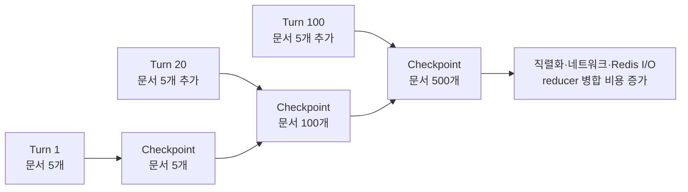
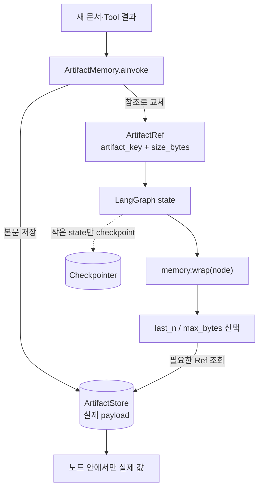
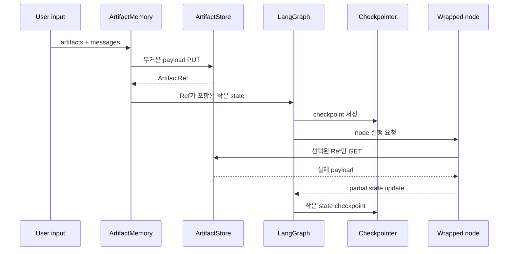
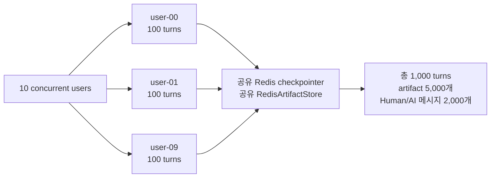
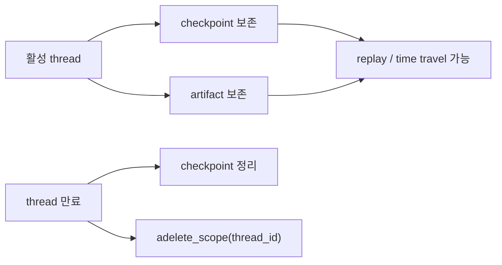

# 대화가 길어질수록 느려지는 LangGraph state, ArtifactRef로 가볍게 만들기

> `langgraph-artifact-memory`를 만들게 된 이유부터 설계, 성능 검증, 실제 적용 방법까지


LangGraph로 대화형 워크플로우를 만들다 보면 어느 순간 이런 고민을 하게 된다.

> 대화가 길어질수록 `messages`, 검색 문서, Tool 결과를 state에 계속 쌓아도 괜찮을까?

처음에는 state가 조금 커져도 큰 문제가 없어 보인다. 하지만 대화가 수십, 수백 turn으로
늘어나고 파일과 Tool 결과까지 누적되기 시작하면 양상이 달라진다. 체크포인터는 매번 더 큰
state를 읽고 직렬화하고 저장해야 한다. Redis를 사용하더라도 저장 대상 자체가 계속 커지면
네트워크 전송량과 체크포인트 지연도 함께 커진다.

그렇다고 모든 내용을 요약해 버리면 나중에 원문이 필요할 때 다시 찾을 수 없다. 반대로 원문을
state에 계속 유지하면 체크포인트가 무거워진다. 이 두 선택지 사이에서 시작한 실험이
[`langgraph-artifact-memory`](https://github.com/sungreong/langgraph-artifact-memory)다.

이 글에서는 다음 내용을 다룬다.

1. 왜 이 문제를 별도 라이브러리로 풀려고 했는가
2. `ArtifactRef`와 선택적 hydrate가 어떤 역할을 하는가
3. 메시지, 파일, Tool 결과를 어떻게 관리하는가
4. 10명의 동시 사용자와 1,000턴을 어떻게 성능 테스트했는가
5. 어떤 환경에서 사용할 수 있고 실제 코드는 어떻게 작성하는가
6. 이 방식이 잘 맞는 경우와 오히려 불필요한 경우는 무엇인가

## 문제는 Redis가 아니라 반복해서 저장하는 state의 형태였다

처음에는 Redis checkpointer에 데이터가 쌓이는 것이 문제라고 생각하기 쉽다. 하지만 더
정확하게 말하면 문제는 Redis 자체보다 **매 체크포인트에 같은 무거운 본문이 반복해서
포함되는 구조**에 있었다.

예를 들어 한 turn마다 4 KB 문서 5개를 `artifacts` 리스트에 추가한다고 해보자.

```python
class State(TypedDict, total=False):
    artifacts: Annotated[list[dict[str, Any]], operator.add]
    messages: Annotated[list[BaseMessage], add_messages]
```

100턴이 지나면 문서가 500개가 된다. reducer가 리스트를 병합할 때도 커진 값을 다루고,
체크포인터가 state를 저장할 때도 누적된 본문을 다시 직렬화한다. 메시지도 함께 증가한다면
체크포인트 크기는 더 빠르게 커진다.



여기서 중요한 질문은 “데이터를 버릴 것인가?”가 아니었다.

> 그래프 실행에 필요한 상태와, 나중에 다시 읽을 수 있어야 하는 무거운 본문을 같은 곳에
> 같은 형태로 보관해야 하는가?

## state를 control plane과 data plane으로 나누기

해결 방향은 workflow 시스템에서 오래 사용해 온 reference pattern에서 찾았다.

- 그래프 state에는 routing과 reducer에 필요한 작은 참조를 둔다.
- 실제 문서나 Tool 결과는 별도 artifact store에 둔다.
- 본문이 필요한 노드에서만 필요한 범위만 복원한다.

`langgraph-artifact-memory`에서는 이 작은 참조를 `ArtifactRef`라고 부른다.

```python
class ArtifactRef(TypedDict):
    artifact_key: str
    size_bytes: int
```

참조는 의도적으로 두 필드만 가진다. 저장소 key와 크기만 있으면 본문을 다시 읽고,
`max_bytes` 제한을 적용할 수 있기 때문이다.



이 구조에서 LangGraph는 여전히 state와 thread를 관리한다. 라이브러리가 LangGraph를
대체하거나 별도 graph node를 추가하는 것은 아니다. 그래프 진입 전과 node 실행 직전에
값의 형태를 바꾸는 얇은 계층에 가깝다.

## 무엇을 만들었는가

현재 `0.4.0`에는 다음 기능이 들어 있다.

| 기능 | 역할 |
|---|---|
| `ArtifactRef` | 체크포인트에 저장되는 작은 참조 |
| `Externalize` | 어떤 state 채널을 원소별 또는 전체 값으로 외부화할지 설정 |
| `Hydrate` | 노드가 복원할 최근 항목 수와 최대 byte를 제한 |
| `ArtifactMemory.wrap()` | 노드 실행 전 hydrate하고 반환값은 다시 외부화 |
| `ArtifactMemory.ainvoke()` | 최초 input checkpoint 전에 입력 payload를 외부화 |
| `MessageWindow` | 최신 메시지와 keep 메시지만 state에 유지 |
| Message archive | window에서 밀려난 메시지를 삭제하지 않고 별도 보관 |
| State schema 검증 | key 오타, `itemized` 불일치, 잘못된 node 반환 형태를 조기 발견 |
| 비동기 I/O 정책 | 동시성 제한, timeout, retry, backoff, capacity 제한 |
| Metric | put/get/archive, byte, latency, retry, failure, queue wait 계측 |

저장소는 용도에 따라 선택할 수 있다.

| 저장소 | 영속성 | 여러 프로세스·Pod 공유 | 권장 용도 |
|---|---:|---:|---|
| `InMemoryArtifactStore` | 없음 | 불가능 | 테스트, 짧은 로컬 실행 |
| `LocalArtifactStore` | 있음 | 불가능 | 로컬 개발, 단일 서버 |
| `RedisArtifactStore` | 있음 | 가능 | 여러 worker 또는 Pod가 있는 서비스 |

## LangGraph 안에서 어디에 들어가는가

그래프만 그리면 구조는 평범하다.


`externalize`, `hydrate`, message window는 별도 노드가 아니라 `ArtifactMemory`와 node
wrapper 내부에서 동작한다.



따라서 기존 graph topology를 복잡하게 만들지 않으면서도 체크포인트와 실제 본문의 저장
위치를 분리할 수 있다.

## 설치와 지원 버전

현재 문서와 테스트의 기준은 패키지 `0.4.0`이다.

| 구성요소 | 지원 범위 |
|---|---|
| `langgraph-artifact-memory` | `0.4.x` |
| Python | CPython `3.10-3.13` |
| LangGraph | `>=1.2,<2` |
| `langgraph-checkpoint` | `>=4.2,<5` |
| `langchain-core` | `>=1.4.7,<2` |
| Redis Python client | `>=5,<9` (`redis` extra) |
| 실행 방식 | Async |

LangGraph 1.2 이상을 요구하는 이유는 message window에서 기존 메시지 리스트를 제한된
리스트로 교체할 때 `langgraph.types.Overwrite`를 사용하기 때문이다.

기본 저장소만 사용한다면 다음과 같이 설치한다.

```bash
pip install langgraph-artifact-memory
```

Redis 저장소도 사용한다면 optional extra를 추가한다.

```bash
pip install "langgraph-artifact-memory[redis]"
```

저장소를 직접 clone해서 확인하는 단계라면 다음 방식도 가능하다.

```bash
git clone https://github.com/sungreong/langgraph-artifact-memory.git
cd langgraph-artifact-memory
pip install -e ".[redis]"
```

## 가장 작은 사용 예제

### 1. state가 실제 값과 참조를 모두 받을 수 있게 선언한다

```python
import operator
from typing import Annotated, Any

from langchain_core.messages import BaseMessage
from langgraph.graph.message import add_messages
from typing_extensions import TypedDict

from langgraph_artifact_memory import ArtifactRef


class State(TypedDict, total=False):
    artifacts: Annotated[
        list[dict[str, Any] | ArtifactRef],
        operator.add,
    ]
    messages: Annotated[list[BaseMessage], add_messages]
    answer: str
```

체크포인트 안에서는 `artifacts`가 `ArtifactRef` 리스트지만, hydrate된 노드 안에서는 실제
딕셔너리 리스트로 보인다. 그래서 state 타입에는 두 형태를 모두 표현한다.

### 2. 외부화 정책과 저장소를 설정한다

```python
from langgraph_artifact_memory import (
    ArtifactIOPolicy,
    ArtifactMemory,
    Externalize,
    MessageWindow,
)
from langgraph_artifact_memory.redis import RedisArtifactStore


artifact_store = RedisArtifactStore(
    "redis://localhost:6379/0",
    prefix="my-artifacts",
)

memory = ArtifactMemory(
    artifact_store,
    externalize={
        "artifacts": Externalize(itemized=True),
    },
    message_window=MessageWindow(
        max_messages=20,
        max_kept_messages=20,
    ),
    io_policy=ArtifactIOPolicy(
        max_concurrency=16,
        put_timeout=5.0,
        get_timeout=2.0,
        max_retries=2,
    ),
    state_schema=State,
    validation="strict",
)
```

`itemized=True`는 리스트 전체를 하나의 blob으로 저장하지 않고 각 원소를 별도 참조로
바꾼다. 그래야 최근 5개만 복원하는 것처럼 부분 hydrate가 가능하다.

### 3. 실제 값이 필요한 노드만 감싼다

```python
from langgraph_artifact_memory import Hydrate


def answer_node(state: State) -> dict[str, Any]:
    # 여기서는 최근 artifact가 실제 dict로 복원되어 있다.
    artifacts = state["artifacts"]
    return {
        "answer": f"retrieved={len(artifacts)}",
    }


builder.add_node(
    "answer",
    memory.wrap(
        answer_node,
        hydrate={
            "artifacts": Hydrate(
                last_n=5,
                max_bytes=1_000_000,
            ),
        },
    ),
)
```

큰 문서가 수백 MB라면 전체를 hydrate하면 안 된다. `last_n`과 `max_bytes`는 노드가 한 번에
복원하는 양을 제한한다. keyword/vector 검색이 필요하다면 application-level retrieval을
추가하고, 검색된 결과만 노드 입력으로 전달하는 편이 낫다.

### 4. 외부화 대상 입력은 `memory.ainvoke()`로 실행한다

```python
config = {
    "configurable": {
        "thread_id": "conversation-123",
    }
}

result = await memory.ainvoke(
    graph,
    {
        "artifacts": new_artifacts,
        "messages": [user_message],
    },
    config,
    durability="sync",
)
```

`graph.ainvoke()`를 직접 호출하면 외부화하기 전의 원본 입력이 최초 input checkpoint에
들어갈 수 있다. 외부화 대상 입력이 있다면 반드시 `memory.ainvoke()`를 사용해야 한다.

## 메시지는 무조건 요약하지 않고 window + archive로 관리한다

대화 관리에서 가장 어려운 선택은 “모두 유지할 것인가, 요약할 것인가”였다. 요약은 모델
입력을 줄이는 데 유용하지만, 원문을 완전히 대체하면 나중에 정확한 내용을 다시 찾기 어렵다.

`MessageWindow`는 이 둘을 분리한다.

- 최근 메시지는 graph state에 둔다.
- 명시적으로 keep한 메시지는 별도 상한 안에서 유지한다.
- window에서 밀려난 메시지는 삭제하지 않고 archive로 옮긴다.

```python
from langchain_core.messages import HumanMessage
from langgraph_artifact_memory import mark_message_kept

preference = mark_message_kept(
    HumanMessage(content="항상 한국어로 답변해 주세요."),
)

old_messages = await memory.aget_archive(
    "conversation-123",
    limit=20,
)
```

keep 메시지에도 반드시 상한이 있어야 한다. 중요한 메시지를 계속 pin할 수 있게 만들고
상한을 두지 않으면 결국 다른 형태의 무한 누적이 된다. 큰 Tool 본문은 keep하지 말고
artifact로 저장한 뒤 메시지에는 참조나 짧은 요약만 남기는 것이 좋다.

## 설정 실수를 체크포인트에 쓰기 전에 잡기

라이브러리를 사용하면서 생길 수 있는 대표적인 실수는 state schema와 설정 key가 어긋나는
것이다.

```python
externalize={
    "artfacts": Externalize(itemized=True),  # 오타
}
```

`state_schema=State`와 `validation="strict"`를 설정하면 생성 시점에 다음과 같은 문제를
확인한다.

- 존재하지 않는 `externalize`, `hydrate`, `message_window` key
- `itemized=True`인데 state 채널이 리스트가 아닌 경우
- state annotation에 `ArtifactRef`가 빠진 경우
- wrapped node가 itemized 채널에 리스트가 아닌 값을 반환한 경우

오타가 가까운 기존 key와 비슷하면 `Did you mean 'artifacts'?` 같은 제안도 제공한다. 기존
프로젝트에 점진적으로 적용할 때는 `validation="warn"`, 검증을 끄려면
`validation="off"`를 사용할 수 있다.

## 성능 테스트는 어떻게 설계했는가

단순히 Redis `SET`과 `GET`만 측정하면 실제 LangGraph의 병목을 놓치기 쉽다. 확인하고 싶었던
것은 다음 세 가지였다.

1. 대화가 길어질수록 turn latency가 얼마나 증가하는가
2. 체크포인트 크기와 읽기·쓰기 시간이 어떻게 변하는가
3. artifact를 별도 저장하는 비용까지 포함했을 때 전체 실행시간과 Redis 메모리가 줄어드는가

그래서 microbenchmark와 end-to-end benchmark를 분리했다.

### Microbenchmark

저장소 자체와 비동기 동시성의 영향을 측정한다.

```bash
python benchmarks/backend_benchmark.py \
  --operations 1000 \
  --payload-bytes 4096 \
  --concurrency 20 \
  --redis-url redis://localhost:6379/0 \
  --output benchmarks/results/my-backend-run.json
```

```bash
python benchmarks/io_policy_benchmark.py \
  --operations 1000 \
  --payload-bytes 4096 \
  --concurrency 1,4,16 \
  --redis-url redis://localhost:6379/0 \
  --output benchmarks/results/my-io-policy-run.json
```

이 테스트는 put/get 처리량과 동시성 정책을 비교하는 데 유용하지만, 체크포인트가 누적될 때의
비용은 보여주지 못한다.

### End-to-end benchmark

실제 그래프를 컴파일하고 Redis checkpointer와 artifact store를 함께 사용했다.



| 조건 | 값 |
|---|---:|
| 동시 사용자 | 10명 |
| 사용자당 turn | 100 |
| 전체 turn | 1,000 |
| turn당 artifact | 4 KB × 5개 |
| turn당 사용자 메시지 | 1 KB |
| answer의 실제 hydrate | 최근 artifact 5개 |
| answer 출력 | digest + 1 KB AI 메시지 |
| Checkpoint durability | `sync` |
| Inline 비교군 | artifact와 모든 메시지를 state에 누적 |
| 개선 구성 | `ArtifactRef` + 최근 메시지 20개 + archive |

각 사용자는 독립적인 `thread_id`를 사용하지만 Redis 연결과 저장소는 공유했다. 개선 구성에서도
answer 노드는 artifact 5개를 실제로 다시 읽었다. 별도 저장 비용을 제외한 숫자를 만들지
않기 위해서다.

또한 전체 평균만 보지 않고 다음 값을 함께 기록했다.

- turn latency의 평균, p50, p95, p99, 최대값
- 사용자별 첫 10턴과 마지막 10턴의 평균
- `aget_tuple`, `aput`, `aput_writes` 시간
- 최대 체크포인트와 채널별 byte 크기
- Redis peak memory와 key 수
- artifact put/get/archive 횟수와 byte

## 결과: 체크포인트가 작아지자 후반 turn이 덜 느려졌다

| 지표 | Inline state | `ArtifactRef` + 메시지 제한 | 개선 |
|---|---:|---:|---:|
| 전체 1,000턴 실행시간 | 164.2초 | 49.2초 | 70.1% 감소 |
| 처리량 | 6.09 turn/s | 20.33 turn/s | 3.34배 |
| 평균 turn latency | 1,634 ms | 490 ms | 70.0% 감소 |
| turn p95 | 3,211 ms | 722 ms | 77.5% 감소 |
| 사용자별 마지막 10턴 평균 | 3,205 ms | 698 ms | 78.2% 감소 |
| 최대 checkpoint | 2,346 KB | 112 KB | 95.2% 감소 |
| artifact 채널 | 2,104 KB | 85 KB | 96.0% 감소 |
| messages 채널 | 242 KB | 25 KB | 89.5% 감소 |
| `aget_tuple` 평균 | 926 ms | 89 ms | 90.4% 감소 |
| `aput` 평균 | 118 ms | 40 ms | 65.7% 감소 |
| Redis peak | 507 MB | 382 MB | 24.6% 감소 |
| 워크로드 메모리 증가분 | 404 MB | 279 MB | 30.9% 감소 |

가장 인상적이었던 결과는 단순히 전체 시간이 줄었다는 점보다 **후반 turn의 지연 증가가
완화됐다는 점**이다. inline state에서는 사용자별 마지막 10턴이 평균 3.2초까지 늘었지만,
참조와 메시지 window를 적용한 구성에서는 약 0.7초였다.

다만 이 결과를 “외부화만 하면 언제나 3.34배 빨라진다”로 해석하면 안 된다.

- 로컬 환경에서 수행한 한 번의 비교 결과다.
- 개선 구성은 artifact 외부화와 bounded message window를 함께 적용했다.
- payload 크기, 그래프 노드 수, Redis 지연, durability에 따라 결과가 달라진다.
- 작은 state에서는 추가 put/get 왕복이 오히려 더 비쌀 수 있다.

## 실패한 첫 구현에서 배운 것: 참조도 작아야 한다

초기에는 `ArtifactRef`를 Pydantic 모델로 만들었다. 체크포인트는 2,346 KB에서 약 227 KB로
줄었지만 RedisJSON/Search 구조 오버헤드 때문에 Redis peak가 약 660 MB까지 증가했다.
inline 방식의 507 MB보다 더 큰 값이었다.

본문을 외부화했으니 무조건 메모리가 줄어들 것이라는 예상이 틀린 것이다. 참조 객체가 많이
누적되는 구조에서는 **참조의 직렬화 형태와 저장소 구조도 비용의 일부**였다.

최종적으로 참조를 두 필드의 `TypedDict`로 바꾸고 불필요한 구조를 줄인 뒤 최대 체크포인트
112 KB, Redis peak 382 MB를 기록했다.

이 실험에서 얻은 핵심은 다음과 같다.

> 큰 본문만 외부화하면 끝나는 것이 아니다. 그래프에 오래 남는 참조 자체도 작고 단순해야 한다.

## 실제 서비스에서는 어떻게 적용할까

처음부터 모든 state key를 외부화하는 것보다 계측하면서 단계적으로 적용하는 편이 안전하다.

### 1. 먼저 커지는 채널을 찾는다

문서, Tool 결과, 이미지 metadata, 분석 이력처럼 turn마다 리스트에 추가되는 채널부터 본다.
작고 routing에 즉시 필요한 값은 state에 그대로 두는 편이 낫다.

### 2. 로컬에서는 InMemory 또는 Local store로 시작한다

API와 reducer 동작을 검증할 때는 운영 Redis가 필요하지 않다. 단위 테스트는
`InMemoryArtifactStore`, 프로세스 재시작까지 확인하려면 `LocalArtifactStore`를 사용할 수
있다.

### 3. 여러 Pod가 같은 thread를 처리하면 공유 저장소를 사용한다

InMemory와 Local store의 참조는 다른 Pod에서 해석할 수 없다. worker가 여러 개인 환경에서는
`RedisArtifactStore` 같은 공용 backend가 필요하다.

### 4. hydrate 예산을 노드별로 정한다

노드마다 `last_n`과 `max_bytes`를 다르게 둔다. routing 노드는 본문을 전혀 복원하지 않고,
answer 노드만 최근 문서 몇 개를 읽는 식이 좋다.

### 5. metric을 보고 동시성과 timeout을 조정한다

```python
snapshot = memory.metrics.snapshot()
print(snapshot["queue_wait_ms"])
print(snapshot["concurrency"])
print(snapshot["timeouts"])
```

`max_concurrency`를 크게 한다고 항상 빨라지는 것은 아니다. Redis connection pool, 네트워크,
payload 크기와 함께 조정해야 한다.

### 6. 체크포인트와 artifact 수명주기를 함께 설계한다



artifact를 먼저 삭제하면 남아 있는 체크포인트가 깨진 참조를 갖게 된다. 반대로 체크포인트만
삭제하고 artifact를 남기면 사용하지 않는 데이터가 쌓인다. replay와 time travel이 필요한
기간까지 고려해 두 보존 정책을 함께 설계해야 한다.

## 언제 사용하는 것이 좋은가

| 잘 맞는 경우 | 이유 |
|---|---|
| 파일·문서·Tool 결과가 turn마다 누적됨 | 반복 체크포인트에서 본문 직렬화를 피할 수 있음 |
| 대화가 수십~수백 turn 이어짐 | 메시지 window와 archive로 state 크기를 제한할 수 있음 |
| 무거운 값을 일부 노드만 사용함 | 필요한 노드에서 필요한 범위만 hydrate 가능 |
| 여러 worker가 Redis checkpointer를 공유함 | 작은 체크포인트로 네트워크와 Redis I/O를 줄일 여지가 큼 |
| 원문을 버릴 수 없어 요약만으로는 부족함 | state에서는 제외하면서 별도 저장소에서 다시 조회 가능 |

## 언제 사용하지 않아도 되는가

| 상황 | 이유 |
|---|---|
| 짧은 대화이고 state가 작음 | 추가 artifact put/get이 더 큰 비용일 수 있음 |
| 모든 노드가 매번 모든 payload를 사용함 | 반복 전체 hydrate로 병목 위치만 바뀔 수 있음 |
| 단순 RAG 검색 결과를 한 turn에서만 사용함 | state에 누적하지 않고 노드 로컬 값으로 처리하는 편이 단순함 |
| 보존·삭제 정책을 운영할 준비가 없음 | checkpoint와 artifact 간 dangling reference 또는 데이터 누적 위험 |

## 왜 LangGraph가 자동으로 해주지 않을까

프레임워크는 어떤 state key가 큰 본문이고 어떤 값이 routing에 즉시 필요한지 알 수 없다.
외부화 정책은 데이터 의미와 맞닿아 있다.

- routing 함수가 실제 값을 필요로 하는가
- reducer가 append, overwrite, message merge 중 무엇을 하는가
- 최근 N개, byte 제한, keyword, vector search 중 어떤 복원 정책이 필요한가
- checkpoint와 artifact를 언제 함께 삭제할 것인가
- tenant와 권한을 어떻게 분리할 것인가

잘못 자동화하면 모든 노드가 불필요한 I/O를 수행하거나 replay가 깨질 수 있다. 이
라이브러리의 목표는 모든 데이터를 자동 판단하는 것이 아니라, 개발자가 명시한 정책을
LangGraph의 `thread_id`, reducer, wrapper, message archive에 일관되게 연결하는 것이다.

## 현재 한계와 다음 단계

현재 구현은 MVP이며 다음 한계가 있다.

- async 실행 중심이다.
- hydrate 정책은 `last_n + max_bytes`이며 keyword/vector search는 application에서 추가해야 한다.
- Redis에서는 artifact별 저장 구조를 사용하므로 대량 환경에는 pipeline이나 묶음 저장이 필요할 수 있다.
- `ArtifactRef` 리스트 자체가 매우 길어지면 manifest/page 단위의 2차 압축이 필요하다.
- S3와 MinIO backend는 roadmap에 있고 현재 구현에는 포함되지 않는다.
- checkpoint와 artifact를 하나의 transaction으로 묶는 기능과 자동 garbage collection은 아직 없다.

## 마치며

이 작업은 “LangGraph를 Rust로 다시 만들면 빨라질까?”라는 질문에서 시작했지만, 먼저 확인해야
했던 것은 언어보다 데이터 흐름이었다. state 전체를 반복 복사하고 직렬화하는 구조라면 일부를
Rust로 바꿔도 네트워크와 저장소 비용은 그대로 남는다.

반대로 state에는 그래프 실행에 필요한 작은 값만 두고, 무거운 본문은 별도로 관리하면 Python
환경에서도 큰 차이를 만들 수 있었다. 물론 모든 워크로드에 정답은 아니다. 작은 state에는
inline 방식이 더 단순하고 빠를 수 있다.

`langgraph-artifact-memory`가 기대하는 사용 방식은 명확하다.

> state를 무조건 비우는 것이 아니라, 그래프가 기억해야 할 것과 저장소가 보관해야 할 것을
> 구분하고, 필요한 순간에 필요한 만큼만 다시 불러온다.

대화가 길어질수록 느려지는 원인을 찾고 있거나, Redis 체크포인트에 문서와 Tool 결과가 계속
누적되고 있다면 먼저 어떤 채널이 얼마나 커지는지 측정해보자. 그다음 가장 무거운 채널 하나만
참조로 바꿔 비교해보는 것이 좋은 출발점이다.

## 링크

- [GitHub 저장소](https://github.com/sungreong/langgraph-artifact-memory)
- [한국어 README](../../README.kr.md)
- [기본 예제](../../examples/basic.py)
- [상태 검증 예제](../../examples/state_validation.py)
- [Backend benchmark](../../benchmarks/backend_benchmark.py)
- [I/O policy benchmark](../../benchmarks/io_policy_benchmark.py)
- [Roadmap](../../ROADMAP.md)

