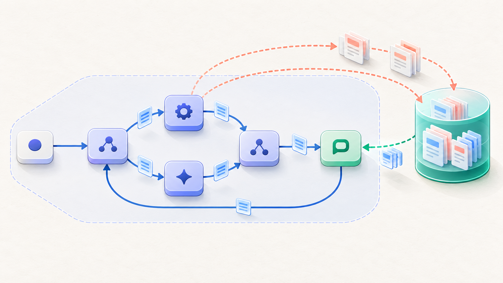
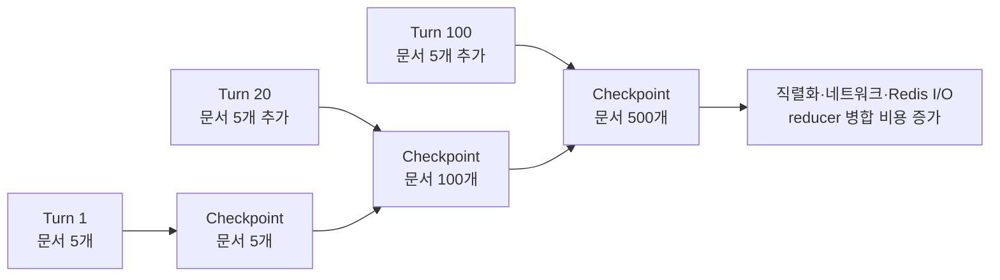
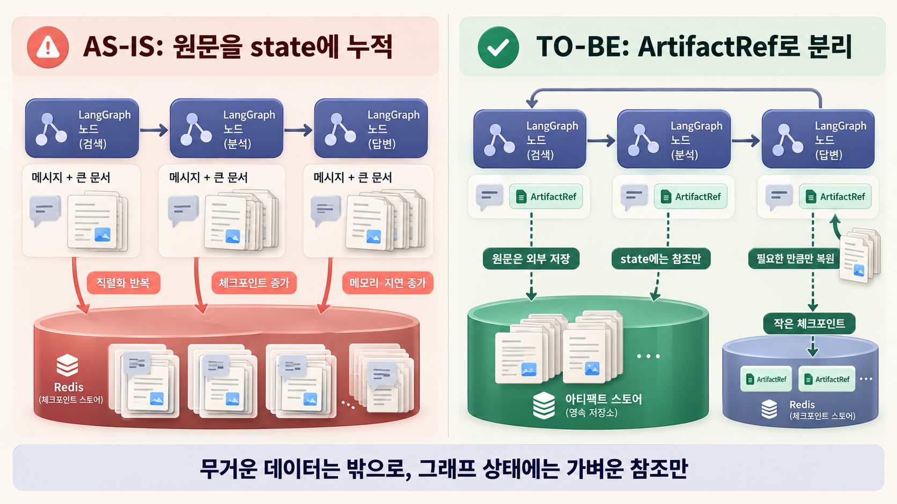
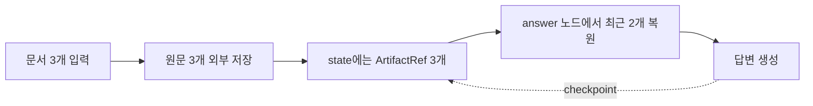
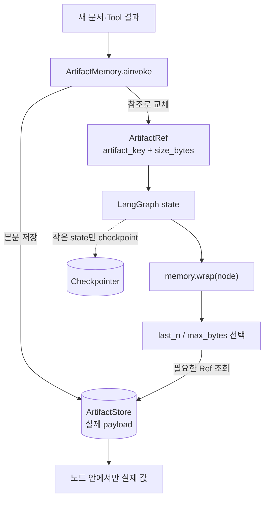
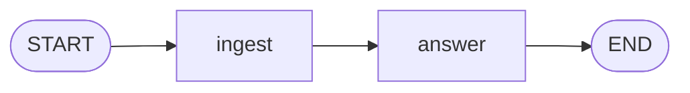
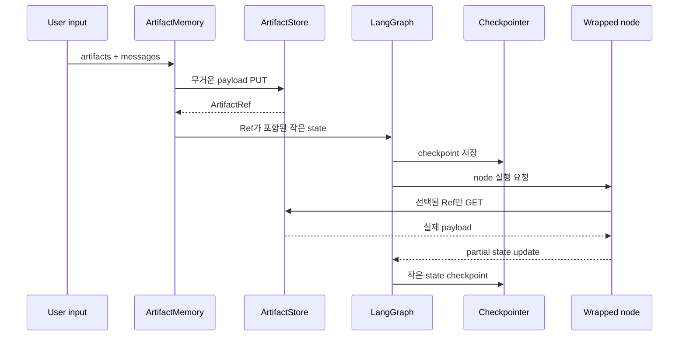
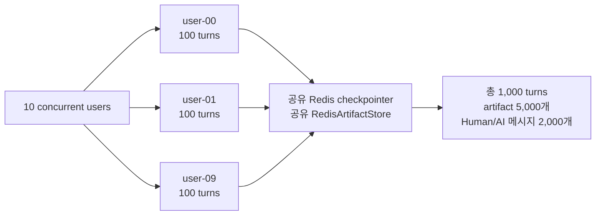
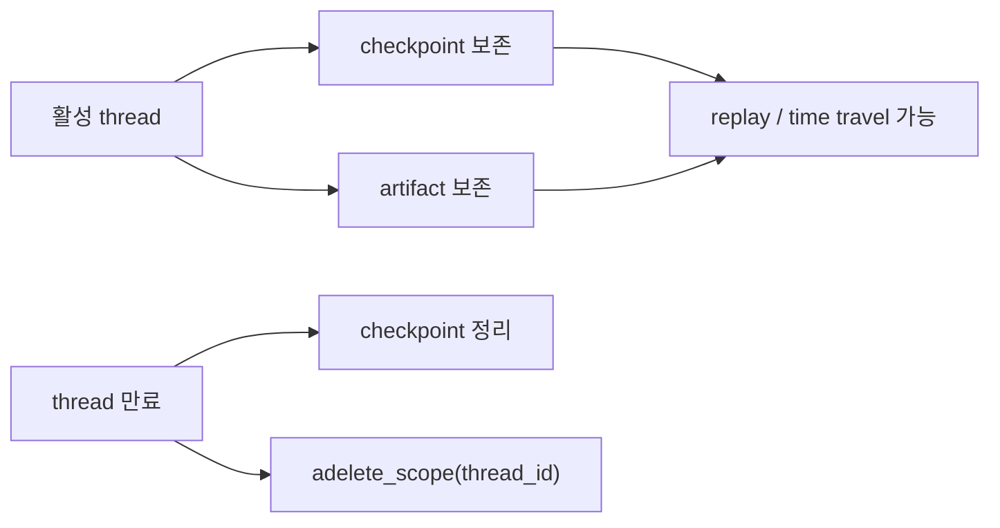

# 대화가 길어질수록 느려지는 LangGraph state, ArtifactRef로 가볍게 만들기

> `langgraph-artifact-memory`를 만들게 된 이유부터 설계, 성능 검증, 실제 적용 방법까지



LangGraph로 대화형 워크플로우를 만들다 보면 어느 순간 이런 고민을 하게 된다.

> 대화가 길어질수록 `messages`, 검색 문서, Tool 결과를 state에 계속 쌓아도 괜찮을까?

처음에는 state가 조금 커져도 큰 문제가 없어 보인다. 하지만 대화가 수십, 수백 turn으로
늘어나고 파일과 Tool 결과까지 누적되기 시작하면 양상이 달라진다. 체크포인터는 매번 더 큰
state를 읽고 직렬화하고 저장해야 한다. Redis를 사용하더라도 저장 대상 자체가 계속 커지면
네트워크 전송량과 체크포인트 지연도 함께 커진다.

그렇다고 모든 내용을 요약해 버리면 나중에 원문이 필요할 때 다시 찾을 수 없다. 반대로 원문을
state에 계속 유지하면 체크포인트가 무거워진다. 이 두 선택지 사이에서 시작한 실험이
[`langgraph-artifact-memory`](https://github.com/sungreong/langgraph-artifact-memory)다.

이 글에서는 다음 내용을 다룬다.

1. 왜 이 문제를 별도 라이브러리로 풀려고 했는가
2. 다른 workflow와 agent 제품들은 비슷한 문제를 어떻게 관리하는가
3. `ArtifactRef`와 선택적 hydrate가 어떤 역할을 하는가
4. 메시지, 파일, Tool 결과를 어떻게 관리하는가
5. 10명의 동시 사용자와 1,000턴을 어떻게 성능 테스트했는가
6. 어떤 환경에서 사용할 수 있고 실제 코드는 어떻게 작성하는가
7. 이 방식이 잘 맞는 경우와 오히려 불필요한 경우는 무엇인가

## 이 작업을 시작한 실제 고민

처음 질문은 “Python 대신 Rust로 만들면 빨라질까?”였다. 하지만 구현 언어를 바꾸기 전에
어디에서 시간이 늘어나는지부터 구분해야 했다. 대화가 길어졌을 때 느려지는 원인은 하나가
아닐 수 있기 때문이다.

| 처음 의심한 지점 | 확인하고 싶었던 것 |
|---|---|
| `messages` 누적 | prompt token뿐 아니라 state 직렬화와 checkpoint 읽기도 느려지는가 |
| 파일·검색 문서·Tool 결과 누적 | 사용하지 않는 노드에서도 같은 원문이 반복 저장되는가 |
| reducer의 list merge | 리스트가 길어질수록 병합과 객체 생성 비용이 커지는가 |
| Redis checkpointer | Redis 자체가 느린가, 아니면 전송하는 state가 커져서 느린가 |
| 외부 저장소 분리 | put/get 왕복 비용이 checkpoint 절감 효과보다 커지지는 않는가 |
| 동시 사용자 증가 | 한 명에게 유효한 최적화가 공유 Redis에서도 유지되는가 |

그래서 처음부터 라이브러리를 정답으로 놓지 않았다. 먼저 inline state를 100턴까지 누적하고,
채널별 byte와 checkpoint I/O를 측정했다. 그다음 10개의 독립 `thread_id`를 동시에 실행했다.
마지막으로 동일한 원문을 외부 저장하되 answer 노드가 실제로 다시 읽게 만들어 전체 시간을
비교했다. 외부화의 저장·조회 비용을 숨기지 않기 위해서였다.

이 과정을 거치며 목표도 바뀌었다. “무조건 저장을 줄이는 도구”가 아니라 다음 질문에 답하는
작은 계층이 필요했다.

> 어떤 값은 checkpoint에 남기고, 어떤 값은 외부로 보내며, 어느 노드에서 얼마만큼 다시
> 불러올 것인가?

## 비슷한 문제를 다른 workflow 시스템은 어떻게 풀고 있을까

이 고민은 LangGraph에만 있는 특수한 문제가 아니다. durable workflow나 task orchestration
시스템은 실행 기록을 안정적으로 남겨야 하므로, 큰 payload를 실행 상태에 그대로 넣을 때
비슷한 비용과 제한을 만난다.

| 시스템 | 공식적으로 제시하는 방식 | 이 라이브러리와 닮은 점 |
|---|---|---|
| LangGraph core | Checkpointer는 thread의 graph state snapshot을, Store는 graph state 밖의 JSON application data를 맡긴다. | checkpoint와 외부 데이터의 역할을 나누는 기반 primitive를 제공한다. |
| LangChain agent | 긴 대화에는 message trim·delete와 `SummarizationMiddleware`를 제공한다. | 모델 context와 message state가 무한히 커지지 않게 제한한다. |
| Deep Agents | filesystem backend로 큰 Tool 결과를 offload하고, 선택적으로 binary content를 content-addressed reference로 바꾼다. | 큰 결과를 외부 backend에 두고 실행 경로에는 작은 참조를 남긴다는 점에서 가장 가깝다. |
| AWS Step Functions | state 사이 payload가 256 KiB를 넘을 수 있으면 S3에 저장하고 bucket ARN과 key를 전달하도록 권한다. | 큰 본문 대신 저장 위치를 가리키는 작은 참조를 workflow가 전달한다. |
| Temporal | payload가 크면 외부 저장소에 두고 Workflow나 Activity에는 참조를 전달하라고 안내한다. 긴 실행은 Continue-As-New 같은 방식으로 history도 관리한다. | 실행 history를 가볍게 유지하고 실제 데이터는 필요할 때 해석한다. |
| Apache Airflow | XCom은 작은 값용이며, 임계값보다 큰 값은 object storage에 저장하고 DB에는 참조를 남기는 hybrid backend를 제공한다. | 크기 정책에 따라 inline과 external storage를 나누는 구조가 거의 같다. |

공식 문서에서 확인할 수 있는 근거는 다음과 같다.

- [LangGraph Persistence: checkpointer와 Store의 역할](https://docs.langchain.com/oss/python/langgraph/persistence)
- [LangChain Long-term memory: Store의 namespace·key 기반 JSON document](https://docs.langchain.com/oss/python/langchain/long-term-memory)
- [LangChain Short-term memory: 긴 메시지 기록의 지연·비용과 관리 전략](https://docs.langchain.com/oss/python/langchain/short-term-memory)
- [Deep Agents overview: history 요약과 큰 결과 offload](https://docs.langchain.com/oss/python/deepagents/overview)
- [Deep Agents backends: Tool 결과·binary content의 filesystem offload](https://docs.langchain.com/oss/python/deepagents/backends)
- [AWS Step Functions: 큰 payload 대신 S3 ARN 사용](https://docs.aws.amazon.com/step-functions/latest/dg/sfn-best-practices.html#sfn-best-practices-avoid-exec-failures)
- [Temporal: 큰 payload는 외부 저장 후 참조 전달](https://docs.temporal.io/references/workflow-task-errors#payloads-too-large)
- [Airflow XCom: 임계값 기반 object storage backend](https://airflow.apache.org/docs/apache-airflow/2.10.5/core-concepts/xcoms.html#object-storage-xcom-backend)

### 이미 있는 기능인데 왜 이 라이브러리를 쓰는가

결론부터 말하면 `langgraph-artifact-memory`는 새로운 database나 checkpoint 알고리즘을
발명한 프로젝트가 아니다. LangGraph에는 이미 Checkpointer와 Store가 있고, LangChain에는
메시지 trim·delete·summarize가 있다. Deep Agents까지 사용하면 filesystem backend와 큰 Tool
결과 offload도 얻을 수 있다.

차이는 **primitive의 존재**와 **기존 custom `StateGraph`에서 반복 구현 없이 사용할 수 있는
정책 계층의 존재** 사이에 있다.

| 필요한 기능 | 기존 공식 기능 | custom `StateGraph`에서 여전히 정해야 하는 것 |
|---|---|---|
| thread 실행 상태 저장 | Checkpointer가 graph state snapshot을 저장한다. | 어떤 큰 값을 snapshot 전에 state 밖으로 뺄지는 application이 정한다. |
| graph 밖의 데이터 저장 | Store가 namespace와 key로 JSON document를 저장·검색한다. | state 값 대신 어떤 reference를 남기고 어떻게 직렬화할지 직접 설계한다. |
| 긴 메시지 관리 | trim, `RemoveMessage`, `SummarizationMiddleware`가 있다. | 원문 보존, keep 상한, archive 조회와 artifact 수명주기는 별도로 만든다. |
| 큰 Tool 결과 관리 | Deep Agents가 큰 결과를 filesystem backend로 offload한다. | 일반 `StateGraph`의 임의 channel과 reducer에 같은 정책을 적용하는 API는 별도다. |
| 필요한 값만 다시 읽기 | Store와 filesystem에서 직접 `get`·`read`할 수 있다. | 노드별 최근 N개, byte 예산, 복원 후 재외부화를 매번 구현한다. |
| 운영 안정성 | 각 backend와 middleware가 개별 기능을 제공한다. | timeout, retry, 동시성, schema 검증, metric과 scope 삭제를 한 정책으로 묶어야 한다. |

공식 public API를 기준으로 보면, 일반 LangGraph `StateGraph`에 다음과 같은 선언을 붙여 임의의
state channel을 checkpoint 전에 자동 외부화하고, 특정 노드에서만 byte 예산 안으로 복원하는
통합 API는 제공되지 않는다. 이는 “LangGraph로 구현할 수 없다”는 뜻이 아니라, Store와 node
코드로 직접 조합해야 한다는 뜻이다.

```python
memory = ArtifactMemory(
    store,
    externalize={
        "documents": Externalize(itemized=True),
        "tool_results": Externalize(itemized=True),
    },
    message_window=MessageWindow(max_messages=20),
    state_schema=State,
    validation="strict",
)
```

이 설정 하나가 대신 연결하는 작업은 다음과 같다.

1. 최초 input checkpoint가 생기기 전에 실제 값을 외부 저장한다.
2. state에는 `artifact_key`와 `size_bytes`만 남긴다.
3. `thread_id`와 state channel을 artifact scope에 연결한다.
4. 지정한 노드에서만 `last_n`, `max_bytes` 안으로 복원한다.
5. 노드 반환값에 다시 큰 값이 들어오면 checkpoint 전에 참조로 바꾼다.
6. reducer와 state schema가 정책과 맞지 않으면 조기에 오류를 낸다.
7. I/O timeout, retry, queue wait와 실제 put/get byte를 같은 metric에서 본다.

따라서 이 프로젝트의 차별점은 저장 primitive 하나가 아니라 다음 조합이다.

> 임의의 LangGraph state channel 외부화 + checkpoint-safe reference + 노드별 선택 복원 +
> message archive + 운영 정책을 기존 graph topology를 바꾸지 않고 한 API로 연결한다.

### 가장 가까운 기존 기능은 Deep Agents다

Deep Agents는 이 문제를 훨씬 적극적으로 다룬다. 큰 Tool 결과를 `/large_tool_results/`에
offload하고, binary content offload를 켜면 message history의 inline media를
content-addressed reference로 교체한 뒤 model call 전에 복원한다. 긴 history를 자동 요약하는
middleware도 기본 stack에 포함한다.

그래서 Deep Agents를 이미 agent harness로 선택했다면 먼저 그 기능을 사용하는 것이 자연스럽다.
`langgraph-artifact-memory`가 겨냥하는 범위는 조금 다르다.

| 비교 축 | Deep Agents | `langgraph-artifact-memory` |
|---|---|---|
| 적용 대상 | `create_deep_agent` harness와 filesystem 도구 | 기존 custom `StateGraph`와 state schema |
| 주 대상 데이터 | Tool 결과, conversation history, file·binary content | 사용자가 지정한 임의 state key와 메시지 |
| 외부화 시점 | middleware와 filesystem 도구의 context 관리 시점 | `memory.ainvoke()`로 최초 input checkpoint 전, wrapped node 반환 후 |
| 복원 방식 | agent가 filesystem 도구로 읽거나 model call 전에 복원 | 노드별 `Hydrate(last_n, max_bytes)`로 전달 |
| 저장 backend | State, filesystem, Store, sandbox, composite backend | InMemory, Local, Redis `ArtifactStore` |
| 운영 초점 | 범용 agent harness와 context engineering | checkpoint 크기, state reducer, artifact I/O 계측 |

Deep Agents 문서도 binary input의 원본이 이전 checkpoint에 남을 수 있다고 설명한다. 반면 이
라이브러리의 `memory.ainvoke()`는 외부화 대상 input을 graph에 넘기기 전에 참조로 바꾸는 것을
명시적인 계약으로 둔다. 어느 방식이 더 낫다기보다, 이미 Deep Agents를 쓰는지 아니면 custom
LangGraph workflow를 유지해야 하는지가 선택 기준이다.

### 상황별로 무엇을 선택하면 되는가

| 상황 | 먼저 선택할 방법 |
|---|---|
| 문제의 대부분이 긴 `messages`와 model token이다 | LangChain의 trim·delete·`SummarizationMiddleware` |
| 사용자 선호나 사실을 여러 thread에서 공유한다 | LangGraph Store와 long-term memory |
| planning, filesystem, sub-agent까지 포함한 agent harness가 필요하다 | Deep Agents의 built-in context management |
| state key 한두 개를 가끔 외부 저장한다 | Store 또는 기존 object storage를 node에서 직접 호출 |
| 기존 custom `StateGraph`에 문서·Tool 결과가 여러 channel로 누적된다 | `langgraph-artifact-memory`의 선언형 externalize/hydrate |
| 모든 노드가 항상 전체 payload를 사용한다 | 외부화보다 state 설계나 retrieval 경계를 먼저 재검토 |

### 에이전트에서는 네 가지 문제를 구분해야 한다

에이전트 제품을 조사하면 `memory`, `context`, `cache`, `file`이라는 단어가 섞여 나온다.
하지만 각각 줄이는 비용과 보존하는 데이터가 다르다.

| 관리 층 | 해결하려는 문제 | 대표적인 방법 | 이 프로젝트와의 관계 |
|---|---|---|---|
| Model context | 모델 입력 token이 너무 길어짐 | 최근 N개 유지, trim, compaction, tool 결과 제거 | `MessageWindow`가 일부 담당하지만 model prompt 구성은 application 책임이다. |
| Long-term memory | 다음 대화에서도 선호·사실·경험을 기억해야 함 | 구조화 memory, semantic search, profile | 장기 memory 자체를 대체하지 않는다. 필요한 memory 결과를 artifact로 보관할 수는 있다. |
| Artifact / source of truth | 파일·문서·Tool 원문이 크지만 다시 읽어야 함 | 외부 저장, ID/URI 전달, 필요한 부분만 retrieval | `ArtifactRef`, externalize, selective hydrate가 직접 담당하는 영역이다. |
| Prompt / KV cache | 같은 prefix를 매 요청 다시 계산함 | prefix cache, context cache, cached token | 추론 비용은 줄이지만 checkpoint 크기나 전송 payload를 줄이지는 않는다. |

따라서 “긴 대화를 요약하면 해결된다”거나 “context cache가 있으니 state 크기는 상관없다”는
결론은 정확하지 않다. 요약과 compaction은 모델 입력을 줄이고, cache는 반복 계산을 줄인다.
반면 artifact 외부화는 graph state와 checkpoint가 반복 운반하는 원문의 크기를 줄인다. 실제
agent 서비스에서는 이 방법들을 서로 대체하기보다 함께 사용한다.

### Agent SDK와 개발 플랫폼에서 보이는 패턴

| 플랫폼 | 공식 문서에 공개된 방식 | 배울 점 |
|---|---|---|
| [OpenAI Agents SDK](https://openai.github.io/openai-agents-python/sessions/) | Session에서 최근 N개만 가져오거나 입력 callback으로 history를 잘라낼 수 있고, `OpenAIResponsesCompactionSession`으로 긴 대화를 압축한다. | 저장된 전체 history와 이번 model call에 넣을 context를 분리한다. 자동 compaction은 streaming 종료를 늦출 수 있어 idle 시점 실행도 고려한다. |
| [Anthropic context engineering](https://www.anthropic.com/research/effective-context-engineering-for-ai-agents) | compaction, 외부 structured note, sub-agent를 함께 사용하고 오래된 Tool 결과를 우선 정리한다. | 모든 trace를 context에 유지하기보다 고신호 정보만 남기고 원문은 외부에서 회수한다. |
| [Google ADK](https://adk.dev/sessions/) | Session, State, Memory, Artifact, context compression을 서로 다른 서비스로 구분한다. [ArtifactService](https://adk.dev/artifacts/)는 파일·이미지 같은 named/versioned binary data를 별도로 저장한다. | 대화 상태, 장기 검색 memory, 큰 파일을 하나의 state 자료구조에 섞지 않는다. |
| [Qwen-Agent](https://qwenlm.github.io/Qwen-Agent/en/guide/core_moduls/context/) | 한도에 도달하면 오래된 turn 제거, Tool response folding, Tool step 제거를 순서대로 적용한다. | 특히 Tool 결과부터 압축·제거한다는 점이 agent state 관리와 직접 연결된다. |
| [Qwen Code Memory](https://qwenlm.github.io/qwen-code-docs/en/users/features/memory/) | 상세 memory는 Markdown 파일에 저장하고 `MEMORY.md`는 제한된 compact index로 유지한다. structured recall은 관련 subtree만 주입한다. | 원문 collection과 prompt에 넣는 index를 분리하는 2단 구조다. |
| [Alibaba Model Studio Memory](https://help.aliyun.com/zh/model-studio/memory/overview/) | 대화에서 핵심 정보를 추출해 장기 저장하고, 이후 semantic retrieval로 관련 memory만 context에 주입한다. | cross-session memory도 전체 재주입보다 관련 항목의 선택적 recall을 사용한다. |
| [DeepSeek API](https://api-docs.deepseek.com/guides/multi_round_chat/) | API는 stateless이므로 호출자가 이전 messages를 다시 보내야 한다. 별도의 [disk context cache](https://api-docs.deepseek.com/guides/kv_cache/)가 동일 prefix의 재계산 비용을 줄인다. | cache hit가 빨라도 history payload 자체는 계속 커질 수 있다. 전송·직렬화와 추론 cache를 따로 측정해야 한다. |
| [Volcengine Ark / Doubao](https://docs.volcengine.com/docs/ark/context-cache?lang=en) | implicit·explicit prefix cache와 session cache를 제공하며, session이 한도에 닿으면 오래된 history 일부를 제거해 다시 저장한다. | bounded history와 cache를 결합하지만, cache 저장량과 TTL도 별도 운영 대상이 된다. |
| [Baidu Qianfan / ERNIE](https://cloud.baidu.com/doc/qianfan/s/Fmh4stv22) | application이 참조할 과거 대화 turn 수를 설정하고, 필요하면 knowledge base retrieval을 함께 사용한다. | history 길이를 명시적으로 제한하고 외부 지식은 retrieval로 가져오는 구조다. |

### ChatGPT·Claude·Gemini·Grok과 중국계 챗봇의 제품 사례

사용자용 챗봇에서도 비슷한 분리가 보인다. 아래 표는 공개된 제품 동작을 비교한 것이며, 각
서비스의 내부 저장 구현이 `ArtifactRef`와 같다는 뜻은 아니다.

| 서비스 | 사용자에게 보이는 관리 방식 | 이 글과 연결되는 지점 |
|---|---|---|
| [ChatGPT Memory](https://help.openai.com/en/articles/8590148-memory-faq) | memory summary, saved memory, past chat, file 같은 source를 구분하고 관련 source를 응답에 사용한다. [Projects](https://help.openai.com/en/articles/10169521-projects-in-chatgpt)는 chat·file·instruction을 한 범위로 묶는다. | 모든 과거 원문을 현재 chat message list에 합치는 대신, 서로 다른 source와 scope로 보존하고 관련 정보를 사용한다. |
| [Claude Projects](https://support.anthropic.com/en/articles/9517075-what-are-projects) | project knowledge가 context 한도에 가까워지면 RAG를 사용해 더 큰 자료를 다룬다. [Past chat search](https://support.anthropic.com/en/articles/10185728-understanding-claude-s-personalization-features)도 필요한 이전 대화를 검색한다. | 큰 project knowledge와 현재 대화 context를 분리하고 필요한 자료를 retrieval한다. |
| [Gemini](https://blog.google/products-and-platforms/products/gemini/temporary-chats-privacy-controls/) | past chats를 개인화에 사용할 수 있고, Temporary Chat은 이후 개인화와 history에서 제외한다. | 대화마다 보존 범위를 달리하고, 장기 memory에 포함할 정보와 일회성 context를 구분한다. |
| [Grok Files·Collections](https://docs.x.ai/developers/files) | chat 파일은 ID로 첨부하고 여러 turn에서 유지한다. 많은 문서는 [Collections Search](https://docs.x.ai/developers/tools/collections-search)로 semantic retrieval한다. | 즉시 사용하는 파일과 장기 document collection을 나누고 검색된 자료만 agent가 사용한다. |
| [Kimi Memory](https://www.kimi.com/help/features/memory-space) | memory space를 파일 형태로 관리하고 past conversation에서 관련 memory를 참조한다. [Projects](https://www.kimi.com/help/features/project)는 instruction·conversation·file을 묶고 project file을 필요할 때 읽는다. | memory index, project file, 현재 conversation을 분리한다. 긴 대화가 한도에 닿으면 요약 후 새 chat으로 이어가도록 안내한다. |
| [Qwen Code](https://qwenlm.github.io/qwen-code-docs/en/users/features/memory/) | session마다 새 context로 시작하되 `QWEN.md`, auto-memory 파일, 제한된 `MEMORY.md` index로 지식을 이어간다. | 복구 가능한 원문 파일과 매번 주입하는 compact index를 분리한다. |
| [DeepSeek](https://api-docs.deepseek.com/guides/responses_api/) | 공식 API는 server conversation 저장과 automatic truncation을 제공하지 않고 stateless 입력과 자동 context cache를 제공한다. | cache는 비용 최적화일 뿐 state lifecycle을 대신하지 않으므로 application이 window·archive·artifact 정책을 가져야 한다. |
| [Doubao / Ark](https://docs.volcengine.com/docs/ark/doubao-assistant?lang=en) | 저장된 conversation ID로 이어갈 수 있고, platform 측 history turn·session cache 정책과 knowledge retrieval을 조합한다. | thread ID와 제한된 history, 외부 knowledge를 조합하는 방식이다. |
| [ERNIE / Qianfan](https://cloud.baidu.com/doc/qianfan/s/Fmh4stv22) | 참조할 과거 turn 수를 조절하며 knowledge base fallback이나 retrieval을 붙인다. | 오래된 대화를 무한정 현재 context에 넣지 않고 별도 지식 경로를 둔다. |

이 비교에서 가장 흥미로운 사례는 Kimi와 Qwen Code다. 둘 다 장기 memory를 파일이나 collection에
보존하면서, 현재 context에는 제한된 index 또는 관련 항목만 넣는 방향을 명시한다. Grok과
Claude Projects도 큰 문서 집합을 현재 message history와 분리하고 검색으로 접근한다. 이는
“원문은 복구 가능한 곳에 남기고 실행 경로에는 작은 선택 결과만 보낸다”는 이 프로젝트의
문제의식과 가깝다.

공통점은 분명하다. 큰 데이터를 workflow 실행 상태에 계속 실어 나르기보다 외부 저장소에 두고,
workflow에는 작은 참조를 전달한다. `langgraph-artifact-memory`는 이 검증된 패턴을 LangGraph의
state channel, reducer, `thread_id`, wrapped node에 바로 연결한다. 또한 파일 원문 외부화와
메시지 window/archive, schema 검증, I/O metric을 함께 다뤄 두 종류의 state가 동시에 커지는
custom workflow에서 반복되는 코드를 줄인다.

즉, 이 프로젝트의 새로움은 저장 기술의 발명이 아니라 **이미 존재하는 primitive를 임의 state
channel 단위로 선언하고, checkpoint 전후와 node 경계에서 일관되게 실행하는 통합 방식**에 있다.

## 문제는 Redis가 아니라 반복해서 저장하는 state의 형태였다

처음에는 Redis checkpointer에 데이터가 쌓이는 것이 문제라고 생각하기 쉽다. 하지만 더
정확하게 말하면 문제는 Redis 자체보다 **매 체크포인트에 같은 무거운 본문이 반복해서
포함되는 구조**에 있었다.

예를 들어 한 turn마다 4 KB 문서 5개를 `artifacts` 리스트에 추가한다고 해보자.

```python
class State(TypedDict, total=False):
    artifacts: Annotated[list[dict[str, Any]], operator.add]
    messages: Annotated[list[BaseMessage], add_messages]
```

100턴이 지나면 문서가 500개가 된다. reducer가 리스트를 병합할 때도 커진 값을 다루고,
체크포인터가 state를 저장할 때도 누적된 본문을 다시 직렬화한다. 메시지도 함께 증가한다면
체크포인트 크기는 더 빠르게 커진다.



여기서 중요한 질문은 “데이터를 버릴 것인가?”가 아니었다.

> 그래프 실행에 필요한 상태와, 나중에 다시 읽을 수 있어야 하는 무거운 본문을 같은 곳에
> 같은 형태로 보관해야 하는가?



왼쪽은 모든 노드와 checkpoint가 큰 원문을 계속 전달하는 방식이다. 오른쪽은 원문을 한 번
artifact store에 저장하고 state에는 `ArtifactRef`만 남긴다. answer 노드처럼 본문이 필요한
곳에서도 전체를 복원하지 않고 `last_n`, `max_bytes` 같은 정책 안에서 선택적으로 읽는다.

## 먼저 예시로 보기: 문서 3개 중 최근 2개만 사용하기

내부 구조를 설명하기 전에 가장 작은 사용 장면부터 보자. 사용자가 문서 3개를 올렸고,
`answer` 노드는 그중 최근 2개만 읽어 답을 만든다고 가정한다.



Redis 없이 메모리 저장소만 사용하면 다음 코드를 그대로 실행해볼 수 있다.

```python
import asyncio
import operator
from typing import Annotated, Any

from langgraph.checkpoint.memory import InMemorySaver
from langgraph.graph import END, START, StateGraph
from typing_extensions import TypedDict

from langgraph_artifact_memory import (
    ArtifactMemory,
    ArtifactRef,
    Externalize,
    Hydrate,
    InMemoryArtifactStore,
)


class State(TypedDict, total=False):
    documents: Annotated[
        list[dict[str, Any] | ArtifactRef],
        operator.add,
    ]
    answer: str


async def main() -> None:
    memory = ArtifactMemory(
        InMemoryArtifactStore(),
        externalize={
            "documents": Externalize(itemized=True),
        },
        state_schema=State,
        validation="strict",
    )

    def answer_node(state: State) -> dict[str, str]:
        # 이 노드 안에서만 최근 문서 2개가 실제 dict로 보인다.
        titles = [document["title"] for document in state["documents"]]
        return {"answer": f"참고한 문서: {', '.join(titles)}"}

    graph = (
        StateGraph(State)
        .add_node(
            "answer",
            memory.wrap(
                answer_node,
                hydrate={
                    "documents": Hydrate(last_n=2),
                },
            ),
        )
        .add_edge(START, "answer")
        .add_edge("answer", END)
        .compile(checkpointer=InMemorySaver())
    )

    result = await memory.ainvoke(
        graph,
        {
            "documents": [
                {"title": "첫 번째 문서", "content": "A" * 4096},
                {"title": "두 번째 문서", "content": "B" * 4096},
                {"title": "세 번째 문서", "content": "C" * 4096},
            ],
        },
        {"configurable": {"thread_id": "quickstart-thread"}},
    )

    print(result["answer"])
    print(result["documents"])


asyncio.run(main())
```

실행 결과의 핵심은 두 가지다.

```text
참고한 문서: 두 번째 문서, 세 번째 문서
[
  {"artifact_key": "...", "size_bytes": 4139},
  {"artifact_key": "...", "size_bytes": 4139},
  {"artifact_key": "...", "size_bytes": 4139}
]
```

`artifact_key`와 `size_bytes`는 실제 payload와 실행 환경에 따라 달라진다.

`answer_node` 안에서는 최근 문서 2개가 실제 딕셔너리로 보인다. 그러나 노드 실행이 끝난 뒤
반환된 graph state와 checkpoint에는 문서 원문이 아니라 작은 `ArtifactRef` 3개가 남는다.
즉, 개발자는 기존처럼 `state["documents"]`를 읽어 답을 만들면서도 checkpoint가 매번 원문을
반복 저장하지 않게 할 수 있다.

| 코드 | 하는 일 |
|---|---|
| `Externalize(itemized=True)` | 입력된 문서를 하나씩 artifact store에 저장하고 참조로 교체한다. |
| `memory.ainvoke(...)` | 최초 input checkpoint가 만들어지기 전에 외부화를 수행한다. |
| `memory.wrap(answer_node, ...)` | 해당 노드가 실행되는 동안만 선택한 참조를 실제 값으로 복원한다. |
| `Hydrate(last_n=2)` | 전체 3개가 아니라 가장 최근 문서 2개만 읽는다. |
| `thread_id` | checkpoint와 artifact를 같은 대화 범위로 묶는다. |

여기서 이 라이브러리의 역할을 한 문장으로 정리할 수 있다.

> LangGraph state에 들어오고 나가는 무거운 값을 자동으로 참조로 바꾸고, 실제 값이 필요한
> 노드에서만 정해진 범위만큼 잠시 복원한다.

## state를 control plane과 data plane으로 나누기

해결 방향은 workflow 시스템에서 오래 사용해 온 reference pattern에서 찾았다.

- 그래프 state에는 routing과 reducer에 필요한 작은 참조를 둔다.
- 실제 문서나 Tool 결과는 별도 artifact store에 둔다.
- 본문이 필요한 노드에서만 필요한 범위만 복원한다.

`langgraph-artifact-memory`에서는 이 작은 참조를 `ArtifactRef`라고 부른다.

```python
class ArtifactRef(TypedDict):
    artifact_key: str
    size_bytes: int
```

참조는 의도적으로 두 필드만 가진다. 저장소 key와 크기만 있으면 본문을 다시 읽고,
`max_bytes` 제한을 적용할 수 있기 때문이다.



이 구조에서 LangGraph는 여전히 state와 thread를 관리한다. 라이브러리가 LangGraph를
대체하거나 별도 graph node를 추가하는 것은 아니다. 그래프 진입 전과 node 실행 직전에
값의 형태를 바꾸는 얇은 계층에 가깝다.

## 무엇을 만들었는가

현재 `0.4.0`에는 다음 기능이 들어 있다.

| 기능 | 역할 |
|---|---|
| `ArtifactRef` | 체크포인트에 저장되는 작은 참조 |
| `Externalize` | 어떤 state 채널을 원소별 또는 전체 값으로 외부화할지 설정 |
| `Hydrate` | 노드가 복원할 최근 항목 수와 최대 byte를 제한 |
| `ArtifactMemory.wrap()` | 노드 실행 전 hydrate하고 반환값은 다시 외부화 |
| `ArtifactMemory.ainvoke()` | 최초 input checkpoint 전에 입력 payload를 외부화 |
| `MessageWindow` | 최신 메시지와 keep 메시지만 state에 유지 |
| Message archive | window에서 밀려난 메시지를 삭제하지 않고 별도 보관 |
| State schema 검증 | key 오타, `itemized` 불일치, 잘못된 node 반환 형태를 조기 발견 |
| 비동기 I/O 정책 | 동시성 제한, timeout, retry, backoff, capacity 제한 |
| Metric | put/get/archive, byte, latency, retry, failure, queue wait 계측 |

저장소는 용도에 따라 선택할 수 있다.

| 저장소 | 영속성 | 여러 프로세스·Pod 공유 | 권장 용도 |
|---|---:|---:|---|
| `InMemoryArtifactStore` | 없음 | 불가능 | 테스트, 짧은 로컬 실행 |
| `LocalArtifactStore` | 있음 | 불가능 | 로컬 개발, 단일 서버 |
| `RedisArtifactStore` | 있음 | 가능 | 여러 worker 또는 Pod가 있는 서비스 |

## LangGraph 안에서 어디에 들어가는가

그래프만 그리면 구조는 평범하다.



`externalize`, `hydrate`, message window는 별도 노드가 아니라 `ArtifactMemory`와 node
wrapper 내부에서 동작한다.



따라서 기존 graph topology를 복잡하게 만들지 않으면서도 체크포인트와 실제 본문의 저장
위치를 분리할 수 있다.

## 설치와 지원 버전

현재 문서와 테스트의 기준은 패키지 `0.4.0`이다.

| 구성요소 | 지원 범위 |
|---|---|
| `langgraph-artifact-memory` | `0.4.x` |
| Python | CPython `3.10-3.13` |
| LangGraph | `>=1.2,<2` |
| `langgraph-checkpoint` | `>=4.2,<5` |
| `langchain-core` | `>=1.4.7,<2` |
| Redis Python client | `>=5,<9` (`redis` extra) |
| 실행 방식 | Async |

LangGraph 1.2 이상을 요구하는 이유는 message window에서 기존 메시지 리스트를 제한된
리스트로 교체할 때 `langgraph.types.Overwrite`를 사용하기 때문이다.

기본 저장소만 사용한다면 다음과 같이 설치한다.

```bash
pip install langgraph-artifact-memory
```

Redis 저장소도 사용한다면 optional extra를 추가한다.

```bash
pip install "langgraph-artifact-memory[redis]"
```

저장소를 직접 clone해서 확인하는 단계라면 다음 방식도 가능하다.

```bash
git clone https://github.com/sungreong/langgraph-artifact-memory.git
cd langgraph-artifact-memory
pip install -e ".[redis]"
```

## 실제 프로젝트에 적용하는 단계별 예제

앞의 quickstart가 전체 동작을 한 번에 보여줬다면, 여기서는 메시지 관리, Redis 저장소,
timeout과 retry까지 포함해 실제 프로젝트 설정을 단계별로 살펴본다.

### 1. state가 실제 값과 참조를 모두 받을 수 있게 선언한다

```python
import operator
from typing import Annotated, Any

from langchain_core.messages import BaseMessage
from langgraph.graph.message import add_messages
from typing_extensions import TypedDict

from langgraph_artifact_memory import ArtifactRef


class State(TypedDict, total=False):
    artifacts: Annotated[
        list[dict[str, Any] | ArtifactRef],
        operator.add,
    ]
    messages: Annotated[list[BaseMessage], add_messages]
    answer: str
```

체크포인트 안에서는 `artifacts`가 `ArtifactRef` 리스트지만, hydrate된 노드 안에서는 실제
딕셔너리 리스트로 보인다. 그래서 state 타입에는 두 형태를 모두 표현한다.

### 2. 외부화 정책과 저장소를 설정한다

```python
from langgraph_artifact_memory import (
    ArtifactIOPolicy,
    ArtifactMemory,
    Externalize,
    MessageWindow,
)
from langgraph_artifact_memory.redis import RedisArtifactStore


artifact_store = RedisArtifactStore(
    "redis://localhost:6379/0",
    prefix="my-artifacts",
)

memory = ArtifactMemory(
    artifact_store,
    externalize={
        "artifacts": Externalize(itemized=True),
    },
    message_window=MessageWindow(
        max_messages=20,
        max_kept_messages=20,
    ),
    io_policy=ArtifactIOPolicy(
        max_concurrency=16,
        put_timeout=5.0,
        get_timeout=2.0,
        max_retries=2,
    ),
    state_schema=State,
    validation="strict",
)
```

`itemized=True`는 리스트 전체를 하나의 blob으로 저장하지 않고 각 원소를 별도 참조로
바꾼다. 그래야 최근 5개만 복원하는 것처럼 부분 hydrate가 가능하다.

### 3. 실제 값이 필요한 노드만 감싼다

```python
from langgraph_artifact_memory import Hydrate


def answer_node(state: State) -> dict[str, Any]:
    # 여기서는 최근 artifact가 실제 dict로 복원되어 있다.
    artifacts = state["artifacts"]
    return {
        "answer": f"retrieved={len(artifacts)}",
    }


builder.add_node(
    "answer",
    memory.wrap(
        answer_node,
        hydrate={
            "artifacts": Hydrate(
                last_n=5,
                max_bytes=1_000_000,
            ),
        },
    ),
)
```

큰 문서가 수백 MB라면 전체를 hydrate하면 안 된다. `last_n`과 `max_bytes`는 노드가 한 번에
복원하는 양을 제한한다. keyword/vector 검색이 필요하다면 application-level retrieval을
추가하고, 검색된 결과만 노드 입력으로 전달하는 편이 낫다.

### 4. 외부화 대상 입력은 `memory.ainvoke()`로 실행한다

```python
config = {
    "configurable": {
        "thread_id": "conversation-123",
    }
}

result = await memory.ainvoke(
    graph,
    {
        "artifacts": new_artifacts,
        "messages": [user_message],
    },
    config,
    durability="sync",
)
```

`graph.ainvoke()`를 직접 호출하면 외부화하기 전의 원본 입력이 최초 input checkpoint에
들어갈 수 있다. 외부화 대상 입력이 있다면 반드시 `memory.ainvoke()`를 사용해야 한다.

## 메시지는 무조건 요약하지 않고 window + archive로 관리한다

대화 관리에서 가장 어려운 선택은 “모두 유지할 것인가, 요약할 것인가”였다. 요약은 모델
입력을 줄이는 데 유용하지만, 원문을 완전히 대체하면 나중에 정확한 내용을 다시 찾기 어렵다.

`MessageWindow`는 이 둘을 분리한다.

- 최근 메시지는 graph state에 둔다.
- 명시적으로 keep한 메시지는 별도 상한 안에서 유지한다.
- window에서 밀려난 메시지는 삭제하지 않고 archive로 옮긴다.

```python
from langchain_core.messages import HumanMessage
from langgraph_artifact_memory import mark_message_kept

preference = mark_message_kept(
    HumanMessage(content="항상 한국어로 답변해 주세요."),
)

old_messages = await memory.aget_archive(
    "conversation-123",
    limit=20,
)
```

keep 메시지에도 반드시 상한이 있어야 한다. 중요한 메시지를 계속 pin할 수 있게 만들고
상한을 두지 않으면 결국 다른 형태의 무한 누적이 된다. 큰 Tool 본문은 keep하지 말고
artifact로 저장한 뒤 메시지에는 참조나 짧은 요약만 남기는 것이 좋다.

## 설정 실수를 체크포인트에 쓰기 전에 잡기

라이브러리를 사용하면서 생길 수 있는 대표적인 실수는 state schema와 설정 key가 어긋나는
것이다.

```python
externalize = {
    "artfacts": Externalize(itemized=True),  # 오타
}
```

`state_schema=State`와 `validation="strict"`를 설정하면 생성 시점에 다음과 같은 문제를
확인한다.

- 존재하지 않는 `externalize`, `hydrate`, `message_window` key
- `itemized=True`인데 state 채널이 리스트가 아닌 경우
- state annotation에 `ArtifactRef`가 빠진 경우
- wrapped node가 itemized 채널에 리스트가 아닌 값을 반환한 경우

오타가 가까운 기존 key와 비슷하면 `Did you mean 'artifacts'?` 같은 제안도 제공한다. 기존
프로젝트에 점진적으로 적용할 때는 `validation="warn"`, 검증을 끄려면
`validation="off"`를 사용할 수 있다.

## 성능 테스트는 어떻게 설계했는가

단순히 Redis `SET`과 `GET`만 측정하면 실제 LangGraph의 병목을 놓치기 쉽다. 확인하고 싶었던
것은 다음 세 가지였다.

1. 대화가 길어질수록 turn latency가 얼마나 증가하는가
2. 체크포인트 크기와 읽기·쓰기 시간이 어떻게 변하는가
3. artifact를 별도 저장하는 비용까지 포함했을 때 전체 실행시간과 Redis 메모리가 줄어드는가

그래서 microbenchmark와 end-to-end benchmark를 분리했다.

### Microbenchmark

저장소 자체와 비동기 동시성의 영향을 측정한다.

```bash
python benchmarks/backend_benchmark.py \
  --operations 1000 \
  --payload-bytes 4096 \
  --concurrency 20 \
  --redis-url redis://localhost:6379/0 \
  --output benchmarks/results/my-backend-run.json
```

```bash
python benchmarks/io_policy_benchmark.py \
  --operations 1000 \
  --payload-bytes 4096 \
  --concurrency 1,4,16 \
  --redis-url redis://localhost:6379/0 \
  --output benchmarks/results/my-io-policy-run.json
```

이 테스트는 put/get 처리량과 동시성 정책을 비교하는 데 유용하지만, 체크포인트가 누적될 때의
비용은 보여주지 못한다.

### End-to-end benchmark

실제 그래프를 컴파일하고 Redis checkpointer와 artifact store를 함께 사용했다.



| 조건 | 값 |
|---|---:|
| 동시 사용자 | 10명 |
| 사용자당 turn | 100 |
| 전체 turn | 1,000 |
| turn당 artifact | 4 KB × 5개 |
| turn당 사용자 메시지 | 1 KB |
| answer의 실제 hydrate | 최근 artifact 5개 |
| answer 출력 | digest + 1 KB AI 메시지 |
| Checkpoint durability | `sync` |
| Inline 비교군 | artifact와 모든 메시지를 state에 누적 |
| 개선 구성 | `ArtifactRef` + 최근 메시지 20개 + archive |

각 사용자는 독립적인 `thread_id`를 사용하지만 Redis 연결과 저장소는 공유했다. 개선 구성에서도
answer 노드는 artifact 5개를 실제로 다시 읽었다. 별도 저장 비용을 제외한 숫자를 만들지
않기 위해서다.

또한 전체 평균만 보지 않고 다음 값을 함께 기록했다.

- turn latency의 평균, p50, p95, p99, 최대값
- 사용자별 첫 10턴과 마지막 10턴의 평균
- `aget_tuple`, `aput`, `aput_writes` 시간
- 최대 체크포인트와 채널별 byte 크기
- Redis peak memory와 key 수
- artifact put/get/archive 횟수와 byte

## 결과: 체크포인트가 작아지자 후반 turn이 덜 느려졌다

| 지표 | Inline state | `ArtifactRef` + 메시지 제한 | 개선 |
|---|---:|---:|---:|
| 전체 1,000턴 실행시간 | 164.2초 | 49.2초 | 70.1% 감소 |
| 처리량 | 6.09 turn/s | 20.33 turn/s | 3.34배 |
| 평균 turn latency | 1,634 ms | 490 ms | 70.0% 감소 |
| turn p95 | 3,211 ms | 722 ms | 77.5% 감소 |
| 사용자별 마지막 10턴 평균 | 3,205 ms | 698 ms | 78.2% 감소 |
| 최대 checkpoint | 2,346 KB | 112 KB | 95.2% 감소 |
| artifact 채널 | 2,104 KB | 85 KB | 96.0% 감소 |
| messages 채널 | 242 KB | 25 KB | 89.5% 감소 |
| `aget_tuple` 평균 | 926 ms | 89 ms | 90.4% 감소 |
| `aput` 평균 | 118 ms | 40 ms | 65.7% 감소 |
| Redis peak | 507 MB | 382 MB | 24.6% 감소 |
| 워크로드 메모리 증가분 | 404 MB | 279 MB | 30.9% 감소 |

가장 인상적이었던 결과는 단순히 전체 시간이 줄었다는 점보다 **후반 turn의 지연 증가가
완화됐다는 점**이다. inline state에서는 사용자별 마지막 10턴이 평균 3.2초까지 늘었지만,
참조와 메시지 window를 적용한 구성에서는 약 0.7초였다.

다만 이 결과를 “외부화만 하면 언제나 3.34배 빨라진다”로 해석하면 안 된다.

- 로컬 환경에서 수행한 한 번의 비교 결과다.
- 개선 구성은 artifact 외부화와 bounded message window를 함께 적용했다.
- payload 크기, 그래프 노드 수, Redis 지연, durability에 따라 결과가 달라진다.
- 작은 state에서는 추가 put/get 왕복이 오히려 더 비쌀 수 있다.

## 실패한 첫 구현에서 배운 것: 참조도 작아야 한다

초기에는 `ArtifactRef`를 Pydantic 모델로 만들었다. 체크포인트는 2,346 KB에서 약 227 KB로
줄었지만 RedisJSON/Search 구조 오버헤드 때문에 Redis peak가 약 660 MB까지 증가했다.
inline 방식의 507 MB보다 더 큰 값이었다.

본문을 외부화했으니 무조건 메모리가 줄어들 것이라는 예상이 틀린 것이다. 참조 객체가 많이
누적되는 구조에서는 **참조의 직렬화 형태와 저장소 구조도 비용의 일부**였다.

최종적으로 참조를 두 필드의 `TypedDict`로 바꾸고 불필요한 구조를 줄인 뒤 최대 체크포인트
112 KB, Redis peak 382 MB를 기록했다.

이 실험에서 얻은 핵심은 다음과 같다.

> 큰 본문만 외부화하면 끝나는 것이 아니다. 그래프에 오래 남는 참조 자체도 작고 단순해야 한다.

## 실제 서비스에서는 어떻게 적용할까

처음부터 모든 state key를 외부화하는 것보다 계측하면서 단계적으로 적용하는 편이 안전하다.

### 1. 먼저 커지는 채널을 찾는다

문서, Tool 결과, 이미지 metadata, 분석 이력처럼 turn마다 리스트에 추가되는 채널부터 본다.
작고 routing에 즉시 필요한 값은 state에 그대로 두는 편이 낫다.

### 2. 로컬에서는 InMemory 또는 Local store로 시작한다

API와 reducer 동작을 검증할 때는 운영 Redis가 필요하지 않다. 단위 테스트는
`InMemoryArtifactStore`, 프로세스 재시작까지 확인하려면 `LocalArtifactStore`를 사용할 수
있다.

### 3. 여러 Pod가 같은 thread를 처리하면 공유 저장소를 사용한다

InMemory와 Local store의 참조는 다른 Pod에서 해석할 수 없다. worker가 여러 개인 환경에서는
`RedisArtifactStore` 같은 공용 backend가 필요하다.

### 4. hydrate 예산을 노드별로 정한다

노드마다 `last_n`과 `max_bytes`를 다르게 둔다. routing 노드는 본문을 전혀 복원하지 않고,
answer 노드만 최근 문서 몇 개를 읽는 식이 좋다.

### 5. metric을 보고 동시성과 timeout을 조정한다

```python
snapshot = memory.metrics.snapshot()
print(snapshot["queue_wait_ms"])
print(snapshot["concurrency"])
print(snapshot["timeouts"])
```

`max_concurrency`를 크게 한다고 항상 빨라지는 것은 아니다. Redis connection pool, 네트워크,
payload 크기와 함께 조정해야 한다.

### 6. 체크포인트와 artifact 수명주기를 함께 설계한다



artifact를 먼저 삭제하면 남아 있는 체크포인트가 깨진 참조를 갖게 된다. 반대로 체크포인트만
삭제하고 artifact를 남기면 사용하지 않는 데이터가 쌓인다. replay와 time travel이 필요한
기간까지 고려해 두 보존 정책을 함께 설계해야 한다.

## 언제 사용하는 것이 좋은가

| 잘 맞는 경우 | 이유 |
|---|---|
| 파일·문서·Tool 결과가 turn마다 누적됨 | 반복 체크포인트에서 본문 직렬화를 피할 수 있음 |
| 대화가 수십~수백 turn 이어짐 | 메시지 window와 archive로 state 크기를 제한할 수 있음 |
| 무거운 값을 일부 노드만 사용함 | 필요한 노드에서 필요한 범위만 hydrate 가능 |
| 여러 worker가 Redis checkpointer를 공유함 | 작은 체크포인트로 네트워크와 Redis I/O를 줄일 여지가 큼 |
| 원문을 버릴 수 없어 요약만으로는 부족함 | state에서는 제외하면서 별도 저장소에서 다시 조회 가능 |

## 언제 사용하지 않아도 되는가

| 상황 | 이유 |
|---|---|
| 짧은 대화이고 state가 작음 | 추가 artifact put/get이 더 큰 비용일 수 있음 |
| 모든 노드가 매번 모든 payload를 사용함 | 반복 전체 hydrate로 병목 위치만 바뀔 수 있음 |
| 단순 RAG 검색 결과를 한 turn에서만 사용함 | state에 누적하지 않고 노드 로컬 값으로 처리하는 편이 단순함 |
| 보존·삭제 정책을 운영할 준비가 없음 | checkpoint와 artifact 간 dangling reference 또는 데이터 누적 위험 |

## 왜 LangGraph가 자동으로 해주지 않을까

프레임워크는 어떤 state key가 큰 본문이고 어떤 값이 routing에 즉시 필요한지 알 수 없다.
외부화 정책은 데이터 의미와 맞닿아 있다.

- routing 함수가 실제 값을 필요로 하는가
- reducer가 append, overwrite, message merge 중 무엇을 하는가
- 최근 N개, byte 제한, keyword, vector search 중 어떤 복원 정책이 필요한가
- checkpoint와 artifact를 언제 함께 삭제할 것인가
- tenant와 권한을 어떻게 분리할 것인가

잘못 자동화하면 모든 노드가 불필요한 I/O를 수행하거나 replay가 깨질 수 있다. 이
라이브러리의 목표는 모든 데이터를 자동 판단하는 것이 아니라, 개발자가 명시한 정책을
LangGraph의 `thread_id`, reducer, wrapper, message archive에 일관되게 연결하는 것이다.

## 현재 한계와 다음 단계

현재 구현은 MVP이며 다음 한계가 있다.

- async 실행 중심이다.
- hydrate 정책은 `last_n + max_bytes`이며 keyword/vector search는 application에서 추가해야 한다.
- Redis에서는 artifact별 저장 구조를 사용하므로 대량 환경에는 pipeline이나 묶음 저장이 필요할 수 있다.
- `ArtifactRef` 리스트 자체가 매우 길어지면 manifest/page 단위의 2차 압축이 필요하다.
- S3와 MinIO backend는 roadmap에 있고 현재 구현에는 포함되지 않는다.
- checkpoint와 artifact를 하나의 transaction으로 묶는 기능과 자동 garbage collection은 아직 없다.

## 마치며

이 작업은 “LangGraph를 Rust로 다시 만들면 빨라질까?”라는 질문에서 시작했지만, 먼저 확인해야
했던 것은 언어보다 데이터 흐름이었다. state 전체를 반복 복사하고 직렬화하는 구조라면 일부를
Rust로 바꿔도 네트워크와 저장소 비용은 그대로 남는다.

반대로 state에는 그래프 실행에 필요한 작은 값만 두고, 무거운 본문은 별도로 관리하면 Python
환경에서도 큰 차이를 만들 수 있었다. 물론 모든 워크로드에 정답은 아니다. 작은 state에는
inline 방식이 더 단순하고 빠를 수 있다.

`langgraph-artifact-memory`가 기대하는 사용 방식은 명확하다.

> state를 무조건 비우는 것이 아니라, 그래프가 기억해야 할 것과 저장소가 보관해야 할 것을
> 구분하고, 필요한 순간에 필요한 만큼만 다시 불러온다.

대화가 길어질수록 느려지는 원인을 찾고 있거나, Redis 체크포인트에 문서와 Tool 결과가 계속
누적되고 있다면 먼저 어떤 채널이 얼마나 커지는지 측정해보자. 그다음 가장 무거운 채널 하나만
참조로 바꿔 비교해보는 것이 좋은 출발점이다.

## 직접 사용해보고 의견을 남겨주세요

`langgraph-artifact-memory`는 현재 `ArtifactRef` 외부화만 제공하는 작은 실험을 넘어 다음을
한 패키지에서 다룬다.

- `InMemoryArtifactStore`, `LocalArtifactStore`, `RedisArtifactStore`
- node별 선택 hydrate와 byte 제한
- message window, keep 정책, 원문 archive
- state schema와 node 반환값 검증
- async timeout, retry, backoff, 동시성·capacity 제한
- checkpoint와 artifact I/O를 비교할 수 있는 metric과 benchmark

### GitHub에서 langgraph-artifact-memory 보기

[GitHub 저장소에서 코드와 예제 확인하기](https://github.com/sungreong/langgraph-artifact-memory)

실제 워크플로우는 문서 크기, node 수, Redis 지연, 보존 정책이 모두 다르다. 그래서 이 저장소의
결과를 그대로 믿기보다 자신의 workload에서 benchmark를 실행해보고, 잘 맞지 않는 사례까지
공유해주면 좋겠다. 버그는 Issue로, 새로운 backend나 hydrate 정책 아이디어는 Discussion 또는
PR로 남겨주면 재현 가능한 테스트를 기준으로 개선해 나갈 계획이다.

특히 다음 피드백을 기다리고 있다.

- 실제 서비스에서 checkpoint가 커지는 state channel 사례
- Redis, Local, InMemory backend별 benchmark 결과
- S3·MinIO backend와 transaction·garbage collection 요구사항
- `last_n + max_bytes`로 부족했던 검색·복원 패턴
- Windows, Linux, 컨테이너 환경에서 발견한 호환성 문제

## 링크

- [GitHub 저장소](https://github.com/sungreong/langgraph-artifact-memory)
- [한국어 README](../../README.kr.md)
- [기본 예제](../../examples/basic.py)
- [상태 검증 예제](../../examples/state_validation.py)
- [Backend benchmark](../../benchmarks/backend_benchmark.py)
- [I/O policy benchmark](../../benchmarks/io_policy_benchmark.py)
- [Roadmap](../../ROADMAP.md)

